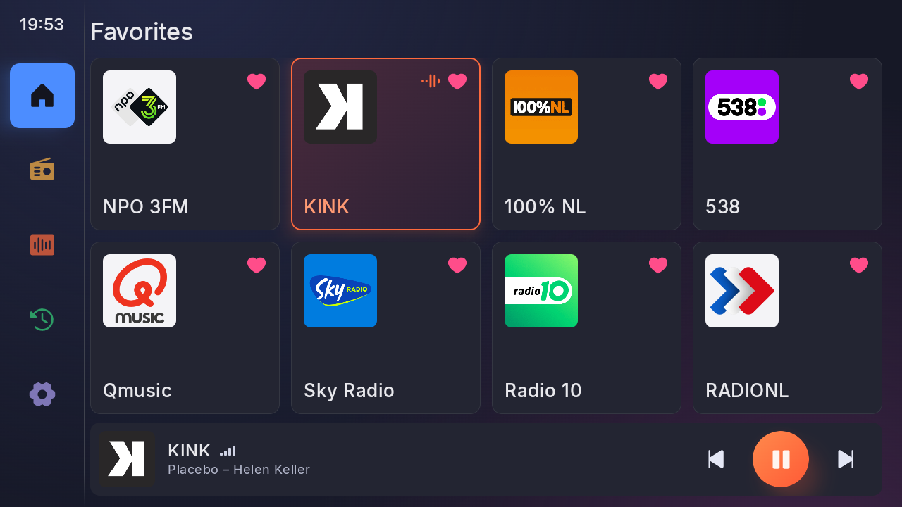
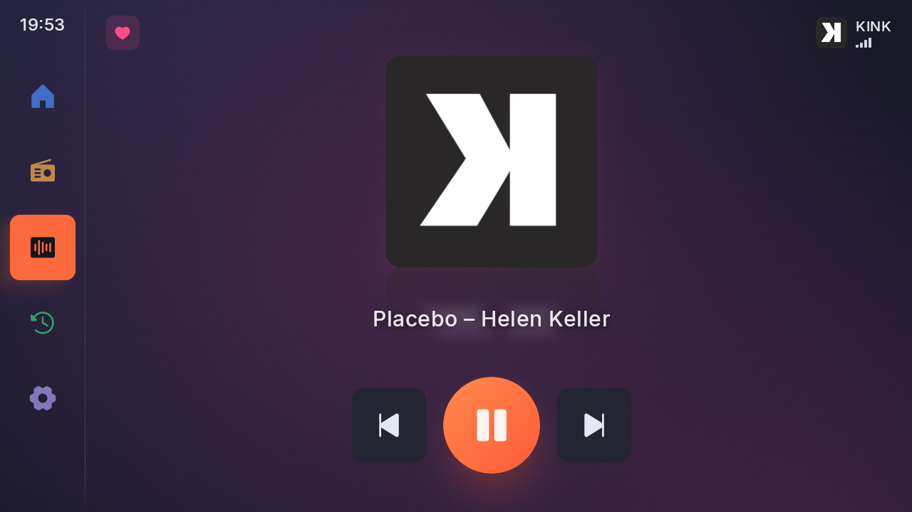
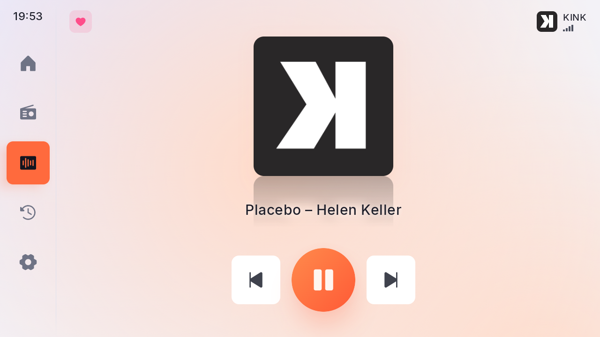
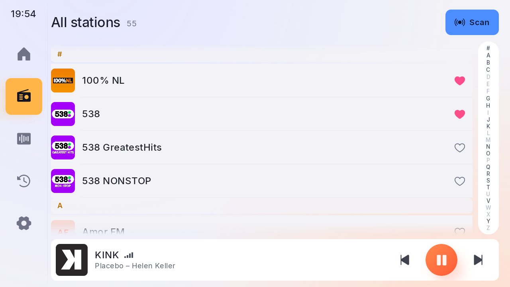
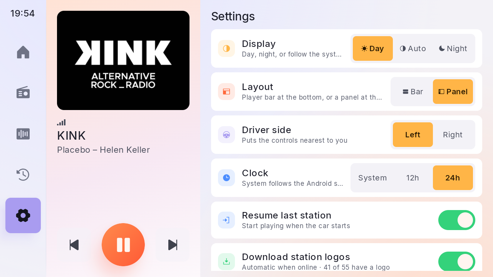

# DABplay+

A car-friendly DAB+ radio app for Android head units, driving a cheap USB DAB+ dongle directly.
Big tiles, big text, few taps: made to be used while driving.



| Now playing (night) | Now playing (day) |
|---|---|
|  |  |
| **Stations (day)** | **Side-panel layout (day)** |
|  |  |

## Features

- **Favourites grid**: eight large tiles on one screen, up to 24, reorder by long-press and drag.
- **Now playing**: "Artist – Title" from the broadcast (DLS / DL Plus), and the station's slideshow (cover cards,
  shown whole, never cropped) or its logo, standing on a soft reflection.
- **Station logos**, downloaded automatically when online (RadioDNS, then the station's website, then
  radio-browser.info) and cached. Offline, everything else still works.
- **Reception handling**: live signal bars, "No signal" while in a tunnel, resumes by itself.
- **Follow station**: when the signal is gone, switches to the same station on another multiplex, using what the
  broadcast announces about itself.
- Steering-wheel buttons through a proper media session, and auto-resume of the last station.
- Two layouts (player bar or side panel), day/night theme, controls on the driver's side (left or right).

## Hardware

- **Dongle:** DTR-100 / "DAB+ Receiver for Android Navigation" (USB `16c0:05dc`, manufacturer `dabusb@126.com`),
  sold under several brands. The dongle demodulates; all DAB decoding happens in the app. More dongle families are
  catalogued in [docs/dongles.md](docs/dongles.md).
- **Android 8 (API 26) and up**, landscape. Designed on 1280×720, scales to other sizes.

## Status

Work in progress. Tested with a real dongle in the Android emulator (USB passthrough); the first run on a real head
unit (Android 10) is next. DAB (classic, MP2) stations are not supported yet, and that's being worked on.

## Building

Needs JDK 25 and the Android SDK:

```
cd android
echo "sdk.dir=$HOME/Android/Sdk" > local.properties      # your SDK path
./gradlew test assembleRelease
```

See [android/README.md](android/README.md) for the emulator setup with USB passthrough.

## Documentation

- [docs/architecture.md](docs/architecture.md): modules, driver interface, playback.
- [docs/protocol.md](docs/protocol.md): the dongle's USB protocol.
- [docs/findings.md](docs/findings.md): hardware findings and the test log.
- [docs/design-notes.md](docs/design-notes.md): UI decisions.
- `tools/`: the Python proof of concept, the reference implementation.

The dongle protocol was reverse engineered for interoperability. This repository contains no vendor apps or
binaries. Station names and logos shown belong to their broadcasters.

## Licence

[MIT](LICENSE). Third-party parts keep their own licences: the Inter font (SIL Open Font License,
`android/app/src/main/assets/licenses/Inter-OFL.txt`), Phosphor icons (MIT), OkHttp and AndroidX/Media3 (Apache 2.0),
dnsjava (BSD).
