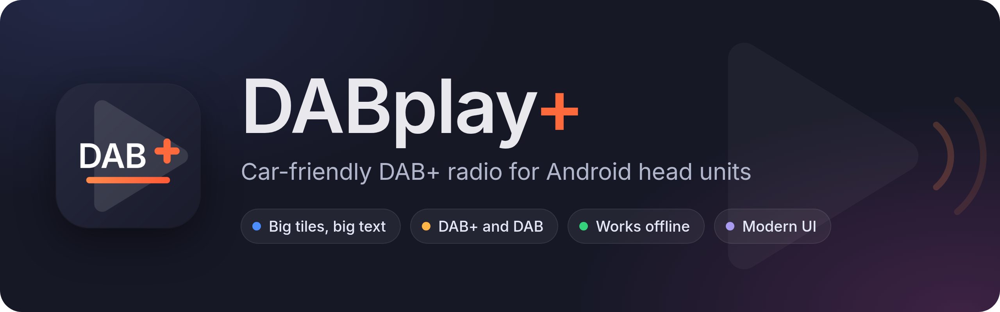

<p align="center"></p>

A car-friendly DAB+ radio app for Android head units, driving a cheap USB DAB+ dongle directly.
Big tiles, big text, few taps: made to be used while driving.

**Download:** the APK is on the [Releases](https://github.com/jvspier/dabplayplus/releases) page. Website:
[jvspier.github.io/dabplayplus](https://jvspier.github.io/dabplayplus/).


| Now playing (night) | Now playing (day) |
|---|---|
|  |  |
| **Stations (day)** | **Side-panel layout (day)** |
|  |  |

## Features

- **Favourites grid**: eight large tiles on one screen, up to 24, reorder by long-press and drag.
- **Now playing**: "Artist – Title" from the broadcast (DLS / DL Plus), and the station's slideshow (cover cards,
  shown whole, never cropped) or its logo, standing on a soft reflection.
- **Station logos**, downloaded automatically when online (RadioDNS, then the station's website, then
  radio-browser.info) and cached; Settings shows how many were found, with Retry missing and Refresh all. Offline,
  everything else still works.
- **DAB+ and DAB (MP2)** stations; DAB uses the app's own MPEG Layer II decoder.
- **Reception handling**: live signal bars, "No signal" while in a tunnel, resumes by itself. Short errors become a
  brief mute instead of a stutter.
- **Follow station**: when the signal is gone, switches to the same station on another multiplex, using what the
  broadcast announces about itself.
- **Traffic announcements** (optional, off by default): switches to traffic news on the same multiplex and back,
  with a banner and Skip; a "TA" badge shows when the station takes part.
- **Plays nicely in the car**: silent during phone calls, quieter under navigation prompts; steering-wheel buttons
  through a proper media session; auto-resume of the last station; Back never leaves the radio by accident.
- **Start with the car** (optional, off by default): opens DABplay+ when the car starts; off, it stays out of the way
  of CarPlay / Android Auto even though the dongle is always connected.
- Two layouts (player bar or side panel), day/night theme, controls on the driver's side (left or right).
- **Backgrounds**: four tints for the page behind everything (Dusk, Ocean, Ember, Aurora), each with a day and a night
  version, plus an optional **Pure black at night** for driving in the dark. Tiles, text and icons stay the same.

## Hardware

- **Android 8 (API 26) and up**, landscape. Designed on 1280×720, scales to other sizes.
- **A USB DAB+ dongle** from the list below.

### Supported dongles

| Dongle | USB ID | Status |
|---|---|---|
| wRadio C100 / DTR-100 / "DAB+ Receiver for Android Navigation" (single antenna), sold under many brands; also confirmed by a user: CAMECHO | `16c0:05dc` | **Tested** |
| C100 "Dual Antenna" (YHX) | `16c0:05dc`, same | **Untested** ([protocol](docs/protocol-c100-highlevel.md)) |
| Si4684 module: Eonon A503, XFA-DAB220 | `1a86:5537` | **Untested** ([protocol](docs/protocol-si4684.md)). The module decodes by itself: no traffic announcements, and service following is the module's own |
| Siano SMS2160 "Rhine800" / Denver TDMB | `187f:0800`, `187f:0700`, `187f:0802` | **Untested** ([protocol](docs/protocol-siano.md)) |
| Siano SMS2270 "Rio" | `187f:0600` | Not supported: needs vendor firmware we can't distribute |

> **About "untested":** only the first dongle has been tested on real hardware. Support for the others is written
> from public sources and from how other apps talk to them, with automated tests against that description, but
> nobody has run it with the real dongle yet. It may work, partly work or not work at all. If you have one of these
> dongles, please [open an issue](https://github.com/jvspier/dabplayplus/issues) and say how it went (the app's
> log helps: `adb logcat -s DabEngine`), and this table gets updated. Other dongle families are catalogued in
> [docs/dongles.md](docs/dongles.md).

## Status

**1.0.0**, not on the Play Store yet. In daily use in a car on a Dudu3 head unit (Android 10, budget-class hardware)
with the DTR-100 dongle: quick and responsive, and through a tunnel it shows "No signal" and is back quickly after
it. Before that it was tested with the same dongle in the Android emulator (USB passthrough): scan, playback,
switching, text, slides, logos, reception loss and recovery, dongle dropouts. The app is tuned for budget head units
(one cached background layer, a baseline profile, decoding that costs well under 1 % of a core).

Not yet verified on air: MP2 (the Netherlands has no MP2 stations; tested against reference files), a real traffic
announcement switch, and following a station to another multiplex while driving (both are covered by tests against
a simulated tuner). Other dongles: see the table above.

## Building

Needs JDK 25 and the Android SDK:

```
cd android
echo "sdk.dir=$HOME/Android/Sdk" > local.properties      # your SDK path
./gradlew test assembleRelease
```

See [android/README.md](android/README.md) for the emulator setup with USB passthrough.

## Documentation

- [docs/architecture.md](docs/architecture.md): modules, driver interface, playback.
- [docs/protocol.md](docs/protocol.md): the DTR-100's USB protocol;
  [protocol-c100-highlevel.md](docs/protocol-c100-highlevel.md), [protocol-si4684.md](docs/protocol-si4684.md) and
  [protocol-siano.md](docs/protocol-siano.md) for the other dongles.
- [docs/findings.md](docs/findings.md): hardware findings and the test log.
- [docs/design-notes.md](docs/design-notes.md): UI decisions.
- `tools/`: the Python proof of concept, the reference implementation.

The dongle protocol was reverse engineered for interoperability. This repository contains no vendor apps or
binaries. Station names and logos shown belong to their broadcasters.

## Licence

[MIT](LICENSE). Third-party parts keep their own licences: the Inter font (SIL Open Font License,
`android/app/src/main/assets/licenses/Inter-OFL.txt`), Phosphor icons (MIT), OkHttp and AndroidX/Media3 (Apache 2.0),
dnsjava (BSD).
